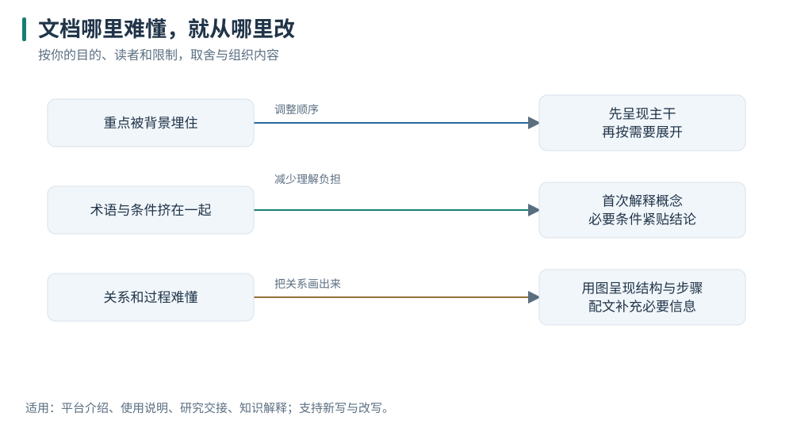
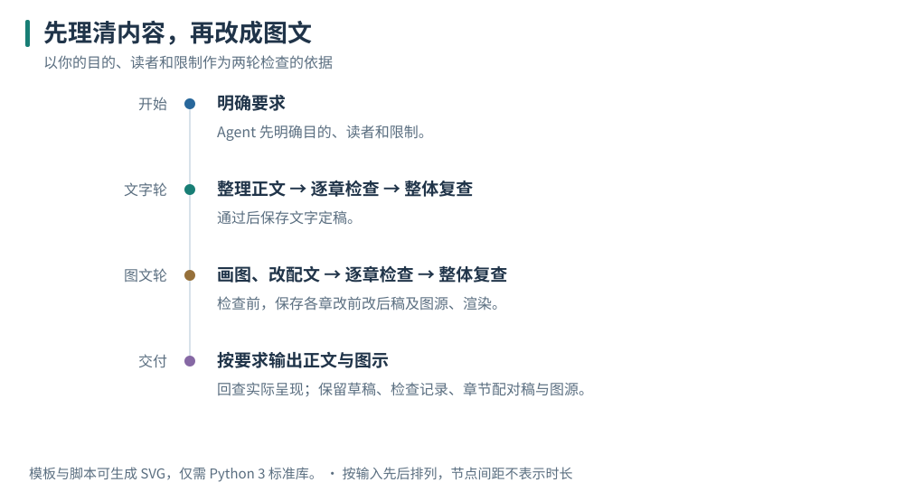

> 这份 README 由 GPT-6 Astra（high）使用 ReadableDocs 编写。[不使用 Skill 的对照版](README.without-skill.md)采用相同模型和同一份 Skill 材料，仅 prompt 中额外要求不使用该 Skill 写作。

# ReadableDocs

**让 Agent 按你的要求，把难懂的文档改得清楚、简洁、重点突出。**

给 Agent 使用的文档写作 Skill（一组任务指引） · **0.0.1**



## 开始使用

把整个 [readable-docs](readable-docs/) 目录放到 Agent 可读取的位置，保留目录结构。将下面的 Skill 路径换成实际路径，按任务调整读者、目的和要求，连同原文交给 Agent：

```text
请使用 ./readable-docs/SKILL.md 改写下面的文档。
读者：第一次使用这个工具的同事。
目的：读完后能完成第一次操作。
要求：简洁，先呈现关键操作；保留必要条件和事实；
用图解释关系与步骤，术语首次出现时解释。
输出：Markdown 正文和引用的图片。

原文：
[粘贴文档，或提供可读取的文件路径]
```



[完整写作流程](readable-docs/SKILL.md) · [绘图模板及用法](readable-docs/references/drawing.md)
