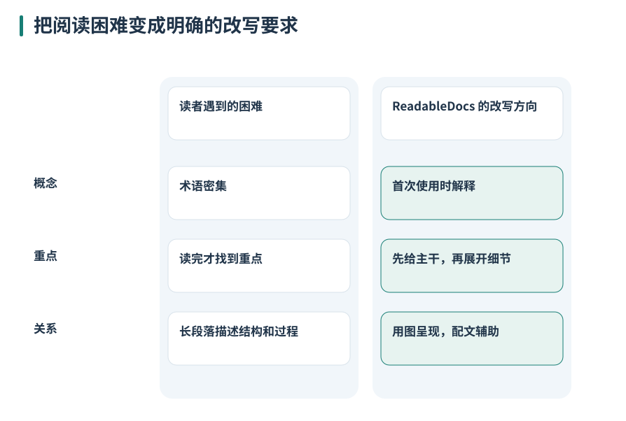
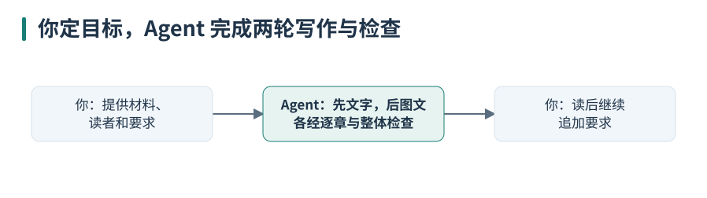
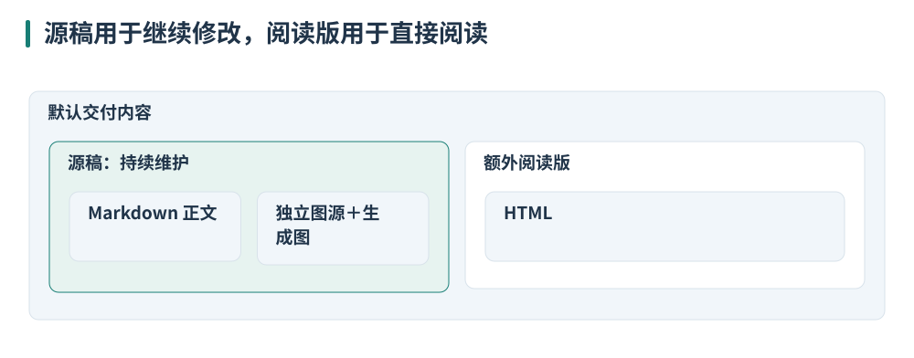

> 这份 README 由 GPT-6 Astra（high）使用 ReadableDocs 编写。[不使用 Skill 的对照版](README.without-skill.md)采用相同模型和同一份 Skill 材料，仅 prompt 中额外要求不使用该 Skill 写作。

# ReadableDocs

**让 Agent 按你的读者和要求，把文档改得更容易理解。** · v0.0.1

ReadableDocs 是一套给 Agent 使用的文档写作 Skill（工作指引），适合平台介绍、使用说明、研究交接和知识解释，也可以从材料开始新写。



必要条件放在图内或附近；代码、公式等需要精确复制的内容继续保留。

## 开始使用

把完整的 `readable-docs/` 文件夹放到 Agent 能读取的位置，再发送下面的提示词。示例路径以当前工作目录为准；放在别处时替换路径。执行绘图脚本需要 Python 3。



## 复制提示词

将方括号替换为实际内容，并提供对应材料。输出格式、长度和必须保留的内容，都可以在提示词中指定。

### 新写一份文档

```text
请读取并使用 ./readable-docs/SKILL.md。
根据 [材料路径]，写一份 [主题] 说明文档。
读者是 [谁、已经了解什么]，读完需要 [理解什么或完成什么]。
要求：[长度、语气、必须包含的内容]。
用图解释核心结构和过程，必要条件保留在对应位置。
交付 [格式及保存位置]，保留可编辑源稿和图源。
```

### 改写看不懂的文档

```text
请读取并使用 ./readable-docs/SKILL.md，改写 [文档路径]。
读者是 [谁]。现在的问题是 [术语太多／重点不清／过程看不懂]。
希望读者先看懂 [核心问题]，再了解 [必要细节]。
把 [重点部分] 改成图解，保留 [关键事实、条件、代码或数据]。
要求：[目标长度、风格、交付格式与位置]。
```

### 继续追加要求

```text
继续使用 ReadableDocs，修改刚才的文档。
新增要求：[更短／面向新手／先说结论／调整语气]。
最需要回答的问题是 [问题]。
请把 [指定部分] 改为 [希望的样子]，保留 [不能丢的信息]。
同步更新写作依据、正文和图源，复查受影响的内容。
交付 [格式及保存位置]。
```

## 交付与继续修改



只需要一种格式时，可要求“只交付 GitHub Markdown 和必要配图”；源稿仍会保留，方便继续修改或换平台。

完整规则见 [SKILL.md](readable-docs/SKILL.md)。
