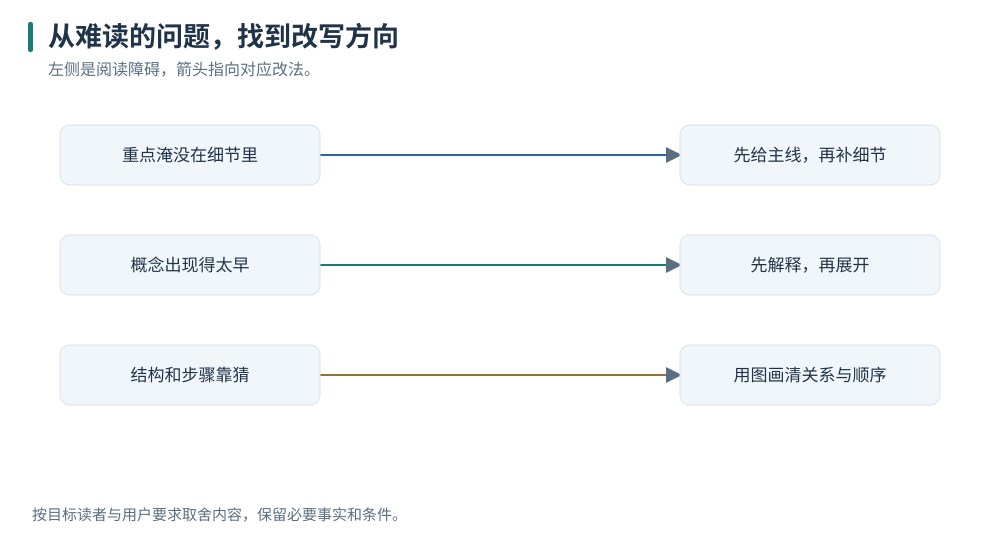

> 这份 README 由 GPT-6 Astra（high）使用 ReadableDocs 编写。[不使用 Skill 的对照版](README.without-skill.md)采用相同模型、目标和同一份 Skill 材料；写作方式上，只明确要求不使用该 Skill 写作。

# ReadableDocs

**让 Agent 把难懂的文档，改成读者看得懂、用得上的样子。**

ReadableDocs 是一套给 Agent 使用的文档写作与检查指令（Skill），当前版本 **0.0.1**。你提供原文、读者和改写要求，Agent 据此调整内容顺序、突出重点，并用图说明结构、关系和步骤。

## 能帮你改什么



适合项目介绍、使用说明、研究交接和知识解释，也可以从材料开始写新文档。

## 开始使用

1. 将本仓库的 `readable-docs/` 整个目录放到 Agent 能读取的位置。
2. 把原文或材料交给 Agent，并发送下面的要求。将路径和方括号内容替换为实际值。

```text
请读取并使用 ./readable-docs/SKILL.md，改写这份文档：[文件路径或原文]。

读者：[谁会读，他们已经知道什么]
目的：[读完要理解什么或完成什么]
要求：[哪里看不懂、哪些信息最重要、希望怎样表达]
限制：[篇幅、必须保留的事实、术语或格式]

请简洁表达并突出重点，用图讲清结构和步骤。
输出到：[目标路径]，保留草稿、检查记录和图源。
```

例如：“写给第一次接触项目的同事；读完能完成首次配置；先说用途，再给操作步骤；保留前置条件和失败处理，删掉与上手无关的细节。”

生成图示需要 Python 3；预览方式见[绘图说明](readable-docs/references/drawing.md)。

## 你会得到什么

得到改写后的文档及所用图示，并保留草稿和检查记录，便于继续调整。交付前，Agent 会检查文字与图文，并回看实际图示和最终输出。

想进一步改写时，可以直接指出：“第二节术语太多，先解释再展开”“把关键结论放在开头”。Agent 会按更新后的要求继续检查和修改。

完整流程见 [Skill 使用说明](readable-docs/SKILL.md)。
